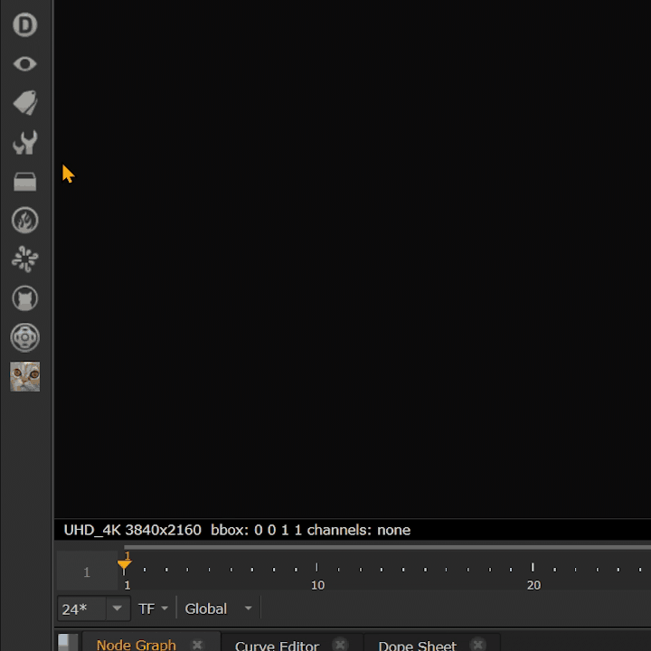
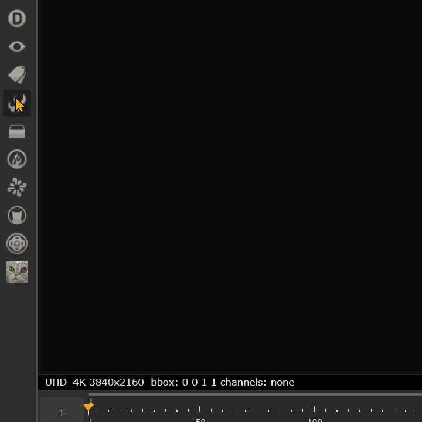
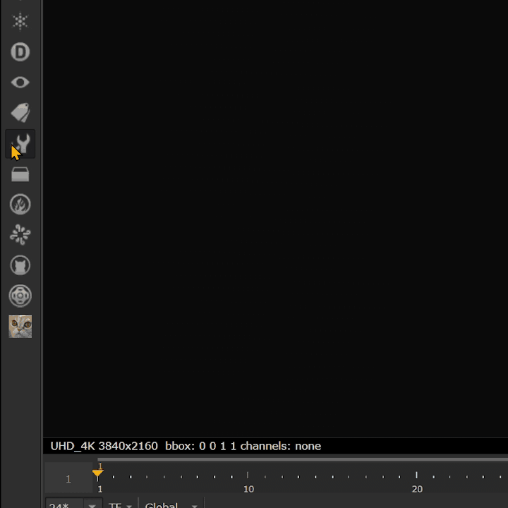
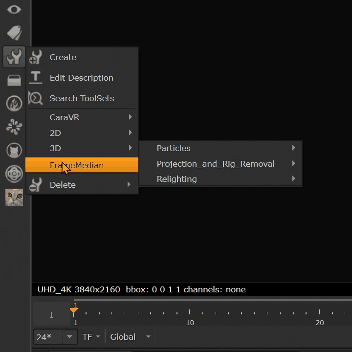

# Nuke Toolset Manager

A custom ToolSet management extension for Foundry Nuke.

The purpose of this tool is to bring some quality-of-life improvements to Nuke's built in ToolSets by introducing editable descriptions, a search panel and menu tooltips.

## Features

- Create ToolSets with descriptions
- Add or edit descriptions for existing ToolSets
- Search ToolSets by name or description
- Display descriptions as tooltips when hovering over ToolSets in the menu

## Installation

1. Download the plugin and ensure the folder is named `ToolsetManager`.
2. Place the folder inside your .nuke directory:
   - **Windows:** `C:\Users\<username>\.nuke\`
   - **Linux:** `~/.nuke/`
3. Open your existing `init.py` file in the `.nuke` directory, or create one if it does not exist.
4. Add the following code:

```python
import nuke
nuke.pluginAddPath("./ToolsetManager")
```

If `import nuke` already exists, do not add it again.

5. Restart Nuke.

Your folder structure should look like this:

```text
.nuke/
├── init.py
└── ToolsetManager/
    ├── menu.py
    ├── toolset_manager.py
    ├── descriptions.json
    ├── README.md
    └── LICENSE
```

You do not need to modify your existing `.nuke/menu.py`.

No additional Python packages are required.

## Included Files

- `toolset_manager.py` - Main plugin code
- `menu.py` - Nuke menu integration
- `descriptions.json` - Stores ToolSet descriptions
- `README.md` - Installation and usage instructions
- `LICENSE` - MIT License

## Usage

Open Nuke's **ToolSets** menu to access the following features.

### Create

Create a ToolSet and give it a description.



### Edit Description

Add or change the description of an existing ToolSet.



### Search ToolSets

Search by ToolSet name or description.



### Menu Tooltips

Hover over a ToolSet in the menu to view its description.



## Description Storage

Descriptions are stored locally in `descriptions.json`, inside the plugin directory.

**Important:** Do not delete or overwrite `descriptions.json` when updating the plugin if you want to preserve your existing descriptions.

## Compatibility

Supports both PySide2 and PySide6.

Tested on:

- **Nuke 14.1v8** - Linux, PySide2
- **Nuke 16.0v6** - Windows, PySide6

Other Nuke versions and operating systems may work but have not yet been verified.

## Notes

- The plugin works on top of Nuke's native ToolSets system. It doesn't change how Nuke saves or loads your ToolSets.
- Descriptions are stored separately, so your original `.nk` ToolSet files remain untouched.